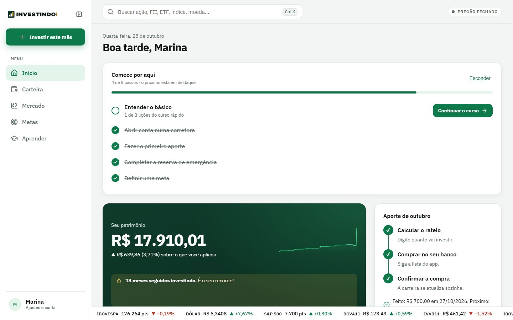
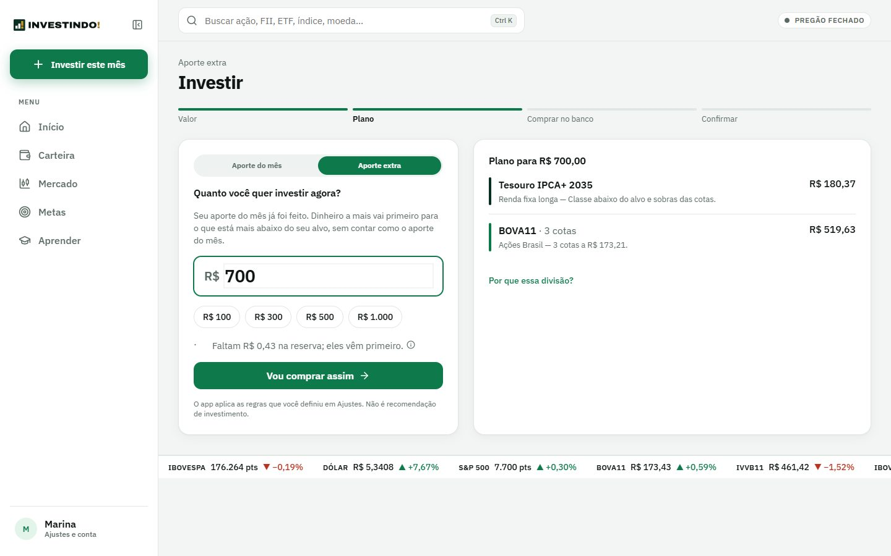
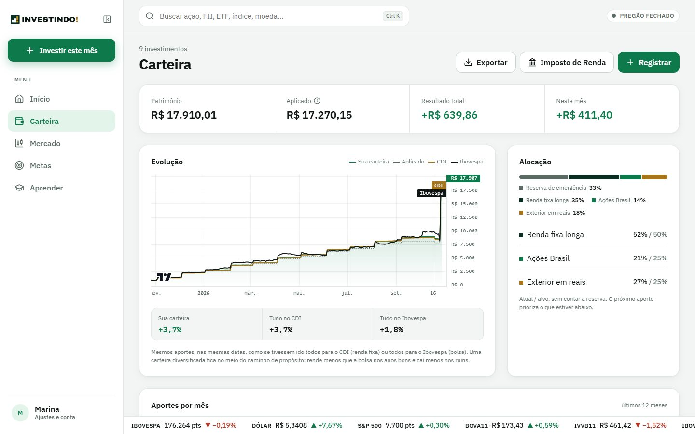
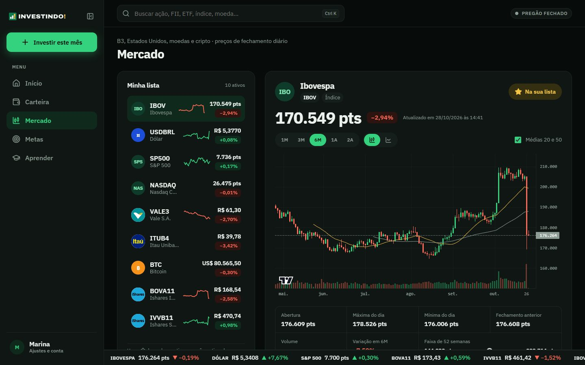
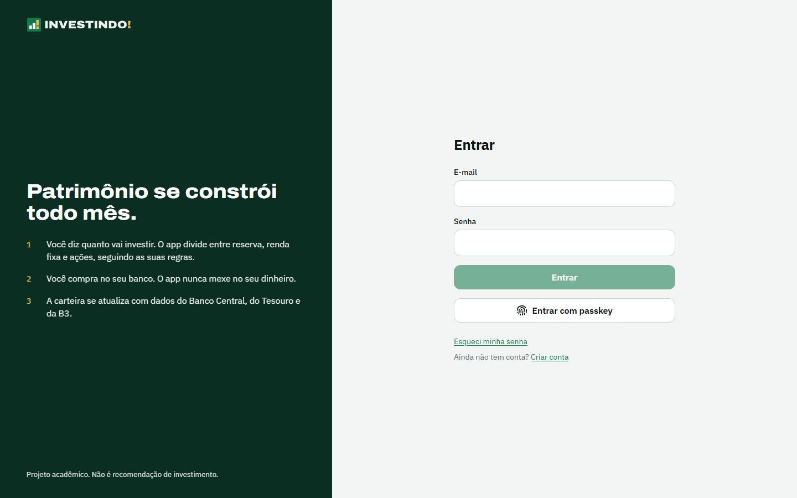
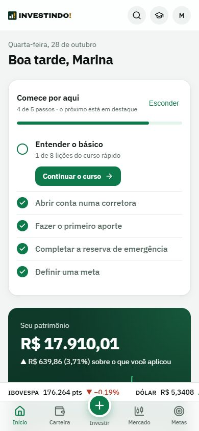
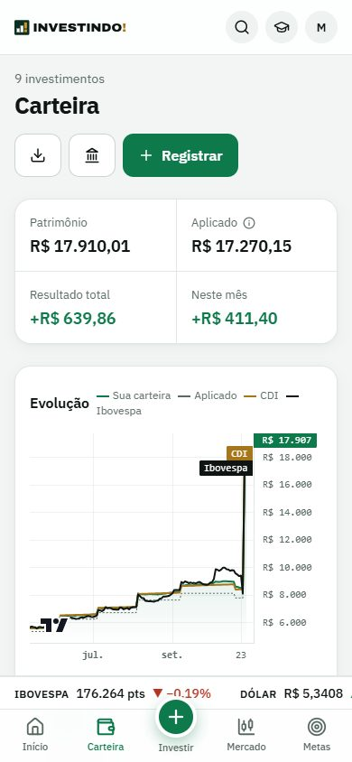
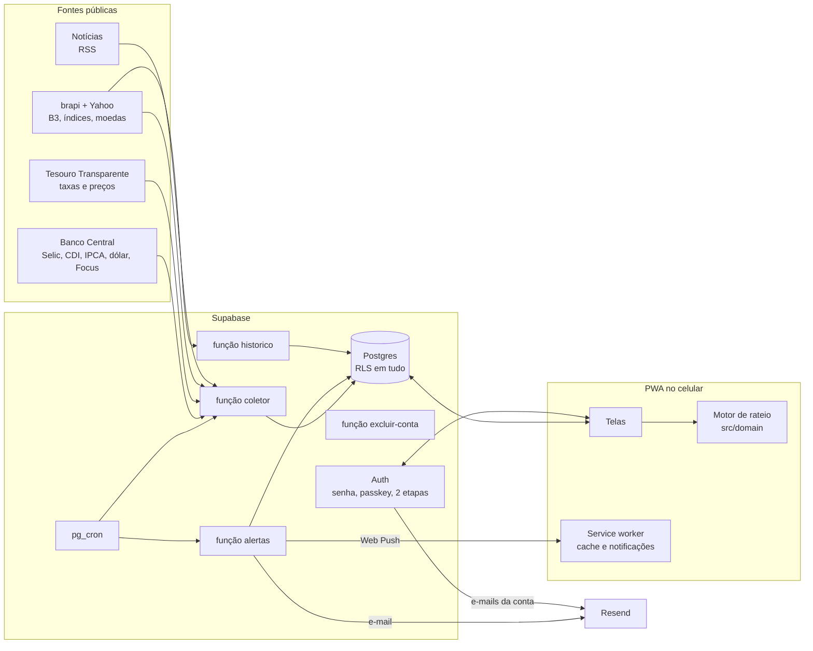

# Investindo!

**Patrimônio se constrói todo mês.** O Investindo! recebe quanto você quer
investir no mês, consulta os indicadores do dia e devolve um rateio pronto:
quanto vai para cada classe e em qual produto, seguindo regras fixas que você
define.

Projeto acadêmico. Não é recomendação de investimento.

- Escopo: `Escopo – App de Investimentos Pessoais.pdf`
- Decisões técnicas, fontes de dados e modelo de dados: [docs/DECISOES.md](docs/DECISOES.md)



## O que o app faz

| Área | O que tem |
| --- | --- |
| **Início** | Patrimônio, indicadores do dia (Selic, CDI, IPCA, juro real, dólar), passo a passo do mês, constância de aportes e notícias |
| **Investir** | Digita o valor e vê o rateio na hora: reserva primeiro, depois as classes abaixo do alvo, com produto e número de cotas. Depois, "marquei como comprado" |
| **Carteira** | Saldo por classe, atual × alvo, evolução comparada com CDI e Ibovespa, **histórico de aportes mês a mês** e registro de compras, vendas e extratos |
| **Mercado** | A B3 inteira (ações, FIIs, ETFs, BDRs) e ativos globais, com busca, minha lista e gráfico de candles |
| **Metas** | Reserva de emergência, projeção de patrimônio em 5, 10 e 20 anos e metas com prazo |
| **Imposto de Renda** | DARF das vendas de ETF, Bens e Direitos em 31/12 e o **relatório anual em PDF** para a declaração |
| **Avisos** | **Notificação no celular** e e-mail no dia do aporte, quando a carteira sai mais de 5 pontos do alvo e quando um título vai vencer |
| **Conta** | Cadastro e recuperação de senha com e-mails próprios (Resend), **passkey** (Face ID / digital) e **verificação em duas etapas** |
| **Aprender** | Curso rápido para quem nunca investiu |

<table>
  <tr>
    <td width="50%"></td>
    <td width="50%"></td>
  </tr>
  <tr>
    <td></td>
    <td></td>
  </tr>
</table>

<p align="center">
  
  &nbsp;&nbsp;
  
</p>

## Arquitetura

Custo zero: um coletor busca os dados públicos e grava no banco; o app faz
todo o cálculo do rateio no próprio aparelho.



- **Dados de cada pessoa** ficam ligados ao `usuario_id` e protegidos por Row
  Level Security. Quem ativou a verificação em duas etapas só lê a própria
  carteira depois de digitar o código: a regra está no banco, não só na tela.
- **Dados de mercado** são só leitura para o app; quem escreve é o coletor,
  com a chave de serviço, nos horários de `supabase/agendamento.sql`.
- **O rateio** é código puro em `src/domain/rateio.ts`, sem rede, coberto por
  testes com os exemplos do escopo.

## Tecnologias

| Camada | Escolha |
| --- | --- |
| App | React 18 + Vite + TypeScript, PWA instalável |
| Banco, login, funções | Supabase (Postgres com RLS, Auth, Edge Functions, pg_cron) |
| E-mails | Resend (SMTP do Supabase e API nas funções) |
| Notificações | Web Push com chaves VAPID |
| Gráficos | Recharts, lightweight-charts e SVG próprio |
| Testes | Vitest (regras) e Playwright + axe-core (ponta a ponta e acessibilidade) |

## Estrutura

```
src/
  domain/      regras puras, sem rede: rateio, renda fixa, carteira, metas, IR, calendário
  lib/         Supabase, sessão, acesso a dados com cache, notificações, formatação pt-BR
  componentes/ componentes do manual de marca
  paginas/     telas (conta, primeiro acesso, Início, Investir, Carteira, Mercado, Metas, IR, Ajustes)
  styles/      tokens do manual de marca e estilos
supabase/
  migrations/  esquema, RLS, catálogo do mercado, alertas e verificação em duas etapas
  functions/   coletor, historico, alertas e excluir-conta (+ _shared com as regras testadas)
  templates/   e-mails da conta (gerados por scripts/gerar-emails.mjs)
  agendamento.sql  pg_cron do coletor e dos alertas
e2e/           testes ponta a ponta e de acessibilidade
public/push-sw.js  recebe as notificações dentro do service worker
```

## Rodando localmente

Requisitos: Node 20+ e Docker.

```bash
npm install
```

```bash
npx supabase start
```

Copie `.env.example` para `.env.local` e cole a `anon key` que o comando acima
mostrou. Depois:

```bash
npm run dev
```

O app abre em http://localhost:5173. Os e-mails locais (confirmação, senha)
chegam no Mailpit, em http://127.0.0.1:54524.

Para popular os dados e testar os avisos, copie `supabase/functions/.env.example`
para `supabase/functions/.env`, preencha os valores (as chaves VAPID saem de
`npx web-push generate-vapid-keys`) e rode:

```bash
npx supabase functions serve --env-file supabase/functions/.env
```

```bash
curl -X POST "http://127.0.0.1:54521/functions/v1/coletor?tarefa=tudo&desde=2024-01-01" -H "Authorization: Bearer SEU_COLETOR_SEGREDO"
```

As notificações dependem do service worker, que só existe no build. Para
testá-las, gere o build e abra a prévia:

```bash
npm run build
```

```bash
npx vite preview --port 4173
```

## Testes

```bash
npm test
```

Testes de regras (Vitest): rateio (incluindo os dois exemplos do escopo),
escolha da renda fixa, curva de CDB/Tesouro, calendário de dias úteis,
carteira, histórico de aportes, imposto de renda, alertas e os leitores de cada
fonte de dados.

```bash
npm run e2e
```

Testes ponta a ponta (Playwright, no Microsoft Edge já instalado), contra o
Supabase local e o app em modo de desenvolvimento. Cada teste cria a própria
conta de teste e apaga no fim:

- fluxo do mês: primeiro acesso, rateio, confirmar a compra e ver a carteira;
- verificação em duas etapas: ativar, exigir o código e o banco recusar os
  dados para uma sessão sem código;
- passkey: criar em Ajustes e entrar sem senha (autenticador virtual);
- acessibilidade: axe-core com as regras WCAG 2.1 A e AA em todas as telas,
  nos temas claro e escuro.

As capturas deste README saem de `scripts/capturar-telas.mjs`.

## Publicando

1. Crie as contas gratuitas: [Supabase](https://supabase.com),
   [Resend](https://resend.com) (com um domínio verificado por SPF e DKIM) e
   [brapi.dev](https://brapi.dev).
2. Vincule o projeto (`npx supabase login` e `npx supabase link --project-ref SEU_PROJETO`)
   e preencha `supabase/functions/.env.producao` a partir do `.env.example`.
3. Rode o script, que aplica as migrações, envia os segredos (e cria as chaves
   das notificações na primeira vez), publica as quatro funções, agenda o
   pg_cron e faz a primeira coleta:

```bash
powershell -ExecutionPolicy Bypass -File scripts/publicar-producao.ps1
```

4. No painel do Supabase, em Authentication:
   - configure o SMTP do Resend (ou use a integração oficial);
   - defina o Site URL com o endereço do app;
   - envie os modelos de e-mail com `node scripts/enviar-modelos-email.mjs`;
   - em **Multi-Factor**, ligue o app autenticador (TOTP);
   - em **Passkeys**, ligue o login com passkey, com o domínio do app como
     relying party (por exemplo `investindo.vercel.app`).
5. Publique o app (Vercel, Netlify ou Cloudflare Pages) com `VITE_SUPABASE_URL`
   e `VITE_SUPABASE_ANON_KEY`. Comando de build: `npm run build`; pasta: `dist`.
